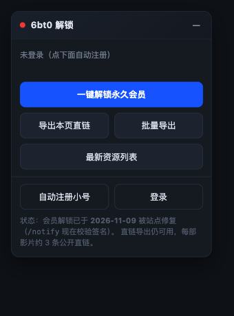

# 6bt0（不太灵） 会员解锁 + 网盘直链导出

> 一个油猴脚本，把影视资源站 6bt0（及 `0bt0`~`9bt0` 全系镜像）的会员墙直接拆掉：
> **一键开永久会员、一键导出全部网盘直链。** 装完点两下就行，不需要懂技术。

**🌐 在线安装页（分享这个链接最省事）：https://yanqing797.github.io/6bt0-unlock/**

**🦞 GreasyFork 发布页：https://greasyfork.org/zh-CN/scripts/604404**　（也可以在 GreasyFork 里搜「6bt0」）



---

## 这是什么

| 能力 | 说明 |
|---|---|
| 🎟️ **一键永久会员** | 利用站点支付回调的鉴权缺陷，0 元开通终身会员（其实是给订单改个状态） |
| 📥 **导出全部网盘直链** | 阿里 / 夸克 / 迅雷 / 百度 / 115 / 光鸭 / UC / 123 / 移动，带提取码，一键复制 + 下载 txt |
| 🧾 **批量导出** | 一次填多个影片 id，串行抓完打包下载 |
| 👶 **自动注册小号** | 没账号？点一下自动注册一个随机账号并登录 |

---

## 三步装上

1. **装油猴**（已经装过就跳过）
   - Chrome / Edge：[Tampermonkey](https://chromewebstore.google.com/detail/tampermonkey/dhdgffkkebhmkfjojejmpbldmpobfkfo)
   - Firefox：[Tampermonkey](https://addons.mozilla.org/firefox/addon/tampermonkey/)
   - Safari：[Userscripts](https://apps.apple.com/app/userscripts/id1463298887) 或 Tampermonkey
   - iPhone Safari 也能用 Userscripts；安卓可用 Kiwi / Firefox + 油猴

2. **装脚本**：点链接 → 油猴弹出安装页 → 点「安装」

   - 国内推荐（GreasyFork CDN，直连不卡）：
     https://greasyfork.org/zh-CN/scripts/604404
   - 备用（GitHub 直链，需要网络能到 `raw.githubusercontent.com`）：
     https://raw.githubusercontent.com/Yanqing797/6bt0-unlock/main/userscript/6bt0-vip.user.js

3. **打开站点**：`https://www.6bt0.com`（镜像 `www.0bt0.com` ~ `www.9bt0.com` 都支持），
   右下角会出现一个「6bt0 解锁」面板。

---

## 怎么用

```
① 没登录 → 点「自动注册小号」→ 面板里出算术验证码 → 填答案 → 自动注册并登录
② 点「一键解锁永久会员」→ 约 3 秒 → 面板显示「会员 ✔ 到期 20xx-xx-xx」
③ 进任意影片详情页 → 点「导出本页直链」→ 直链已复制到剪贴板 + 自动下载 txt
④ 想一次抓多部 → 点「批量导出」→ 填 idcode（就是网址 /mv/<这串数字>）→ 开抓
```

> **idcode 在哪？** 影片页网址 `https://www.6bt0.com/mv/37508847` 里的 `37508847` 就是。

---

## 原理（一句话版）

站点的支付回调 `/notify` **不校验第三方支付网关的签名**：

```
GET /notify?out_trade_no=<订单号>&trade_status=TRADE_SUCCESS
→ success   （订单立刻变成已支付，服务端接着给你写会员时长）
```

所以流程就是：`payOrder` 下一单 → 自己假冒网关点一次 `/notify` → 变永久会员。
签名、金额、订单金额校验全都不存在。细节写在 [docs/how-it-works.md](docs/how-it-works.md)。

---

## 常见问题

**Q：会员时长怎么是到 2036 / 2047 年？**
A：站点按「永久会员 = 3500 天」录时长，叠两次就到 2047 了。点一次就够，重复点会不断叠加（无害）。

**Q：面板没出现？**
A：确认站点域名是 `*.6bt0.com` 或 `*.0bt0.com`~`*.9bt0.com`。站点换域名了就在油猴里手动给脚本加一条 `@match`，
或者用 `bookmarklet/` 里的一行书签版。

**Q：提示「没到账」？**
A：站点大概率修了 `/notify`（加签名校验）。等本项目更新，或者用 `cli/6bt0_vip.py` 看具体报错。

**Q：会被封号吗？**
A：用小号。脚本默认就是自动注册的随机号，随便造。

**Q：导出的链接打不开？**
A：网盘分享本身有失效期，找「更新时间」新的那几条用。脚本已按时间倒序展示。

---

## 仓库结构

```
userscript/6bt0-vip.user.js   油猴脚本（主推，纯浏览器，零依赖）
bookmarklet/                  不想装油猴？用一行书签
cli/6bt0_vip.py               命令行版：注册→白嫖会员→导出，被墙的线路会走境外中继
cli/6bt0_grab.py              只薅免费那几条直链，不用账号
docs/how-it-works.md          漏洞细节、接口清单、失败过的思路
tests/mock_server.py          离线联调用的假站点，改脚本时先在这跑
```

本地验证脚本（不碰真实站点）：

```bash
python3 tests/mock_server.py 8791
# 浏览器打开 http://127.0.0.1:8791/mv/37508847，把 userscript 粘进控制台即可调试
```

---

## 免责

仅供学习网络安全技术使用，请在你自己拥有或已获授权的环境中测试。使用本工具产生的任何后果由使用者自行承担。

## License

MIT
